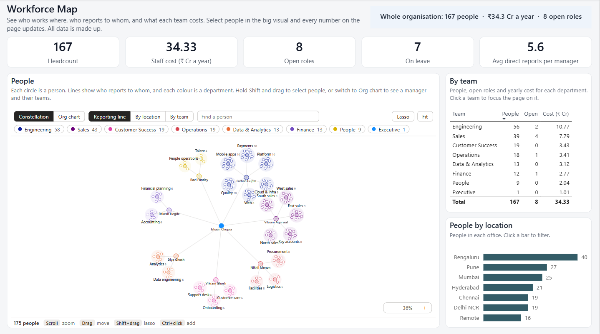
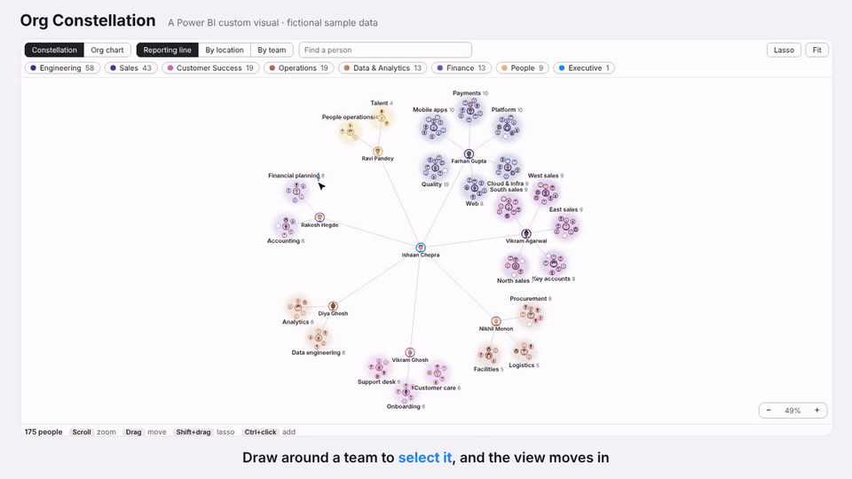
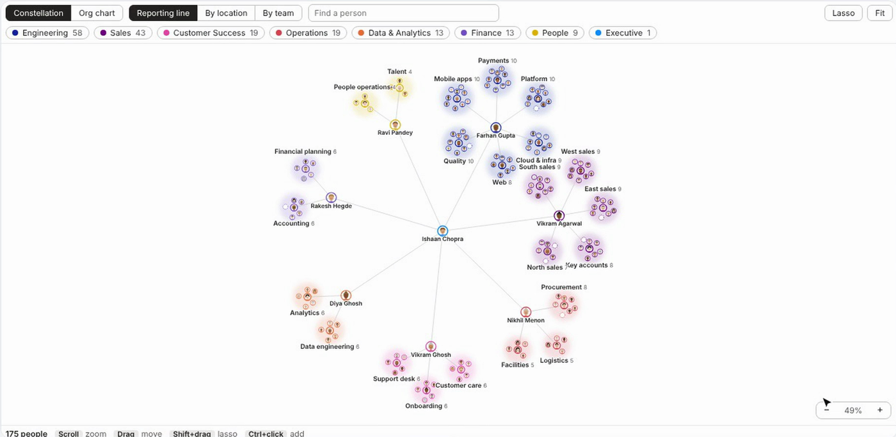
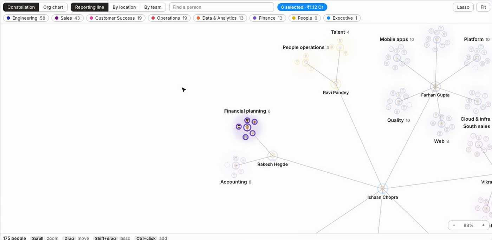
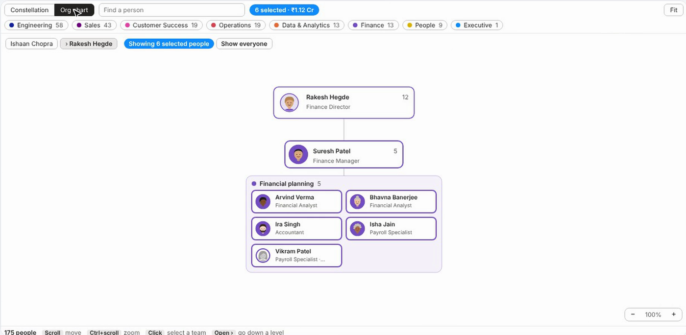

# Org Constellation: a Power BI custom visual for organisations

[](https://github.com/vm8181/org-constellation-powerbi/actions/workflows/ci.yml)

Power BI has no good way to show an organisation. A table lists people, a decomposition tree shows one branch at a time, and neither tells you where people sit or what a group of them costs.

**Org Constellation** is a custom visual, written in TypeScript and D3, that shows the same organisation two ways:

- **Constellation:** the reporting line as a network. The top person sits in the middle, lines run to each director, and from each director to their teams. Every team is a named cluster with its lead in the centre. Switch to **By location** or **By team** to regroup the same people.
- **Org chart:** one manager at a time. Their direct reports are cards, and each team is a box of person cards (name, title, open roles dashed). **Open ›** goes down a level; the trail at the top goes back up.

Draw around people with the **lasso** and the rest of the report page filters to them: headcount, cost, open roles, the team table and the location chart all follow.





▶ **[Watch the full 1-minute demo](docs/video/org-constellation-demo.mp4)** (MP4, no sound)

| Constellation, by reporting line | Lasso: select a group of teams |
| --- | --- |
|  |  |



*All names and numbers are fictional sample data.*

## What it does

| Feature | How it works |
| --- | --- |
| Two views | Constellation and org chart, switched from the visual's toolbar |
| Three groupings | Reporting line (default), location or team; the format pane sets the default |
| Search | Type a name: matches are ringed and the view zooms to the first one. In the org chart, it opens the chart that contains the person |
| Team chips | Constellation: click a team to fade every other team. Org chart: opens that team's chart |
| Lasso | Shift + drag (or the Lasso button) to draw around people; Ctrl adds to the selection. The view moves in a little on the people you picked; **Fit** shows everyone again |
| Selection to org chart | Select people in the constellation, then switch to Org chart: it opens on their common manager and shows only them (and the managers above them). **Show everyone** brings the rest back |
| Reporting line | In the org chart, clicking a manager selects everyone under them; clicking a team box selects the team |
| Cross-filtering | Selections filter every other visual on the page; selections in other visuals highlight people here |
| People | Each person is a small illustrated face, made from their ID so it never changes; the shirt is the team colour. People on leave are faded; open roles are an empty dashed circle |
| Size | Dot size follows a measure, for example annual cost |
| Tooltip card | Who the person is and who they report to, team and location chips, status, team size and cost for managers, cost compared with the average for the same title, time with the company, and the budget of an open role. Rupee amounts in lakh and crore |
| Power BI behaviour | Right-click menu, keyboard focus, bookmarks, high contrast mode and an "add fields" message when empty |

## Try it

You need Power BI Desktop with the **Power BI Project (.pbip)** save option turned on (File > Options > Preview features).

1. Download or clone this repository.
2. Open `powerbi/OrgConstellation.pbip`. The custom visual is packed inside the report, and the sample data is inside the model, so there is nothing to install or connect.
3. Click **Refresh** once to load the data.

If the visual shows "add it to this report first", import `visual/dist/*.pbiviz` from the Visualizations pane (**...** > **Import a visual from a file**) and save.

## Use it with your own data

The visual needs one row per person:

| Field well | Your column | Required |
| --- | --- | --- |
| Person ID | Employee number | Yes |
| Manager ID | The manager's employee number (blank at the top) | Yes |
| Name | Full name | Yes |
| Team | Department | Yes |
| Unit | The team inside the department (Platform, North sales); names the clusters and boxes | No |
| Title, Location, Status | Job title, office, employment status | No |
| Size | A measure, such as annual cost or tenure | No |
| Start date | Joining date; the tooltip shows time with the company | No |
| Budget | A measure with the position's budget; the tooltip shows it for open roles | No |
| Tooltips | Any extra measures | No |

Status values containing "leave" are drawn as on leave, and values containing "open" as open roles. People whose manager isn't in the data, or who are part of a reporting loop, are shown at the top level rather than dropped.

## How it's built

```
data/people.csv  ──►  powerbi/OrgConstellation.SemanticModel   (Power Query table + DAX measures)
                                     │
visual/src/*.ts  ──►  pbiviz package ──►  visual/dist/*.pbiviz  ──►  powerbi/OrgConstellation.Report
                                                                     (packed into CustomVisuals/)
```

| Part | What it is |
| --- | --- |
| `visual/` | The custom visual: `model.ts` turns Power BI rows into a reporting tree, `layout.ts` places people, `visual.ts` draws and handles interaction, `capabilities.json` declares the fields and format options |
| `tools/make_sample_data.py` | Makes the fictional organisation (fixed seed, so it is the same every run) |
| `tools/build_pbip.py` | Writes the whole Power BI project: the model in TMDL, the report page in PBIR, and the visual packed inside it |
| `tools/check_powerbi.py` | Checks the report files against Microsoft's published schemas, every formatting name, every field reference and the page layout |
| `.github/workflows/ci.yml` | On every push: type-checks, lints and packages the visual; confirms the data and report are regenerated exactly; runs the report checks |

## Design decisions

- **A custom visual, not a Fabric App.** It works on Power BI Pro, inside an existing report, on top of an existing semantic model. The same TypeScript could move to a Fabric App later.
- **The same picture every time.** The constellation uses a force simulation, but with a fixed starting arrangement, a fixed random seed and a fixed number of steps. The same data always draws the same layout, so screenshots and bookmarks stay meaningful.
- **The reporting line first.** Grouping by office shows where people are but hides who works with whom. The default network follows the reporting line, so each cluster is a real team with a lead, and the lines show the structure.
- **One manager at a time.** A classic org tree with 20 managers and 150 people is several screens wide. The org chart shows one manager's part of the organisation, with teams as boxes of cards that wrap to the visual's width, so text stays full size.
- **Selections filter by Person ID.** Each dot carries a Power BI selection ID for its person, so a lasso around 40 people filters the page to exactly those 40, whatever other fields are in the visual.
- **Highlight, not re-filter.** When another visual is clicked, people outside it fade rather than disappear, so the layout doesn't jump.

More detail, in plain language, is in the [guide](docs/guide.md). The [spec](docs/spec.md) is what the visual was built against.

## Build from source

```bash
cd visual
npm ci
npx pbiviz package          # -> visual/dist/*.pbiviz
cd ..
python tools/build_pbip.py  # packs the new visual into the report
```

`npx pbiviz start` runs the visual live in the Power BI service for development.

## Status

| Part | Status |
| --- | --- |
| Custom visual: both views, search, chips, lasso, cross-filter, highlight | ✅ |
| Sample model and report page | ✅ |
| CI | ✅ |
| Next | Team colour pickers in the format pane, a "span of control" warning for managers with too many reports, mini KPIs on cluster hover |

Author: Vikash Mishra · MIT licence
